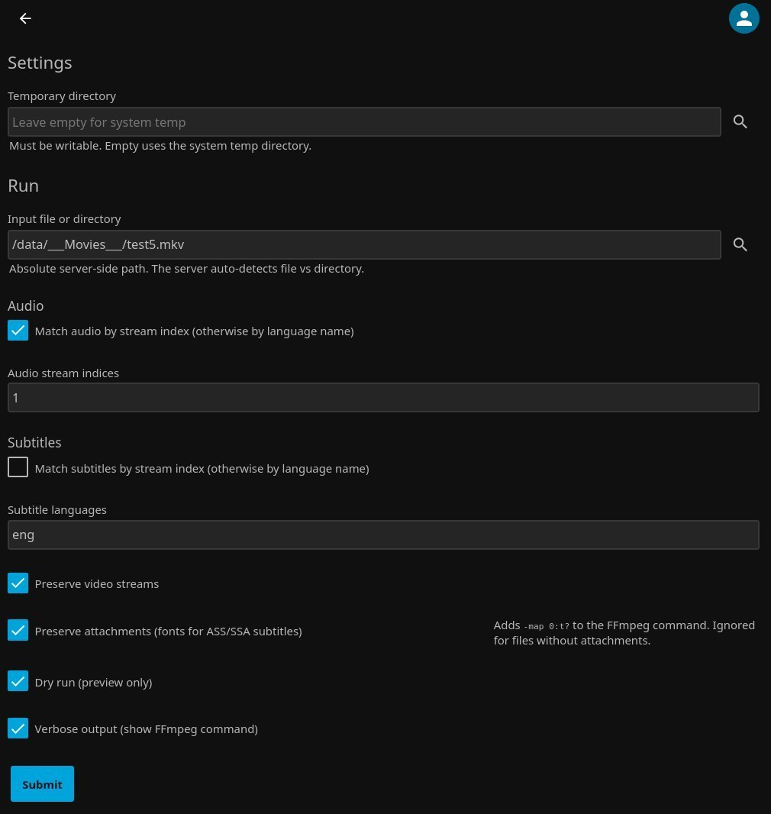
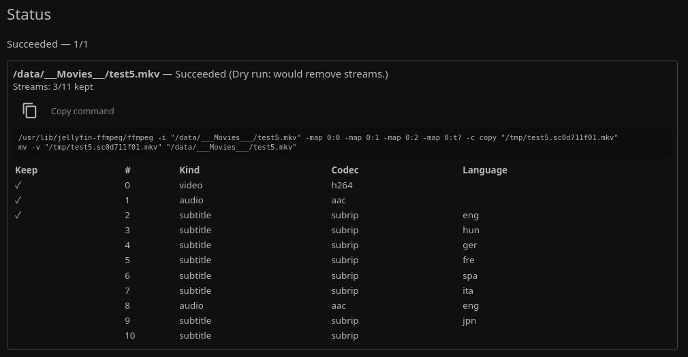

<p align="center">
  
</p>

<h1 align="center">Stream Cleaner</h1>

A Jellyfin plugin that removes unwanted audio and subtitle tracks from media files **without re-encoding**. Stream copy only — no transcoding, no quality loss. Source files are never modified until a fully verified replacement is ready.

## Status

Functional and tested on Linux with both supported Jellyfin lines. The failure paths (read-only source, disk exhaustion, cancellation mid-commit, restart during commit) have not yet been exercised under injection. Do not run this against a library you cannot recover.

## Safety Advisory

> ⚠️ **RUN THIS AT YOUR OWN RISK.** ⚠️

The plugin is built around a prepare-then-commit model:

- Dry run is checked by default.
- Every file is probed, planned, transcoded to a temp file, probed again, copied to a staging file in the source directory, and probed a third time before anything is committed.
- All files in a batch are prepared first. If any file fails preparation, **nothing is committed** — every source remains untouched.
- If all files are prepared, they are committed together: a hardlink backup of each source is created, then all staging files are atomically renamed over their sources on the same filesystem.
- If commit fails partway, every already-committed file is restored from its backup. Backups whose rollback fails are preserved rather than deleted.
- Active Jellyfin playback is checked immediately before commit.

## Features

- Process a single file, a directory, or a directory tree (recursive).
- Select audio streams by language or by absolute stream index.
- Select subtitle streams by language or by absolute stream index.
- Include or exclude video streams.
- Preserve attachment streams (fonts for ASS/SSA subtitles) via `-map 0:t?`.
- Auto-preview: the plugin probes the selected path automatically and shows the stream layout before you submit.
- Dry run, verbose FFmpeg command output, copy-to-clipboard on the displayed command.
- Batch atomic commit with recoverable backups.
- Library item refresh after successful replacement.
- One plugin repository serving both Jellyfin 10.11.x and 12.x.

## Requirements

- Jellyfin 10.11.x or 12.x on Linux.
- FFmpeg and FFprobe installed on the server. The plugin uses the paths Jellyfin itself is configured with — no separate FFmpeg configuration needed.
- Read and write access to the media directories being processed.
- Free space on the media filesystem for one copy of the largest file being processed (during the commit phase).

## Installation

1. Open **Dashboard → Plugins → Repositories**.
2. Click **+**.
3. Name: `Stream Cleaner`
4. URL:
   ```
   https://github.com/vr-ski/jellyfin-stream-cleaner/releases/latest/download/manifest.json
   ```
5. Save, then go to **Catalog** and install **Stream Cleaner**.

Jellyfin selects the correct build for its version automatically:

| Jellyfin | Build | `targetAbi` |
|---|---|---|
| 10.11.x | `0.1.0.11` (net9.0) | `10.11.0.0` |
| 12.x | `0.1.0.12` (net10.0) | `12.0.0.0` |

After installation, restart Jellyfin if prompted. The plugin appears under **Dashboard → Plugins → Stream Cleaner** and in the left dashboard menu.

## Usage

1. Open the plugin page.
2. Under **Settings**, optionally set a temporary directory. Empty uses the system temp directory.
3. Under **Run**:
   - Type a server-side path or click the magnifying glass to browse. The path can be a file or a directory.
   - The plugin probes the path automatically and shows the streams of the file(s) it finds.
   - Choose **Audio**: either comma-separated languages (`eng,jpn`) or stream indices (`1,2`). The toggle decides which input is used.
   - Choose **Subtitles** the same way.
   - Leave **Preserve video streams** checked unless you intend to strip video.
   - Check **Preserve attachments** to keep fonts for ASS/SSA subtitles.
   - Leave **Dry run** checked for a preview that does not touch the files.
4. Click **Submit**.
5. Watch the **Status** panel. It refreshes automatically. Each file shows its stream table with a `✓` on the streams that will be kept.
6. When you are confident in the plan, uncheck **Dry run** and submit again.

Real runs commit only after every file in the batch has been prepared and verified. If any file fails, nothing is changed on disk.

<p align="center">
  

  
</p>
<p align="center">
  <em>
    Settings (left) and Run output with stream plan (right). Click either to enlarge.<br />
    Screenshots use <code>test5.mkv</code> from the
    <a href="https://www.matroska.org/downloads/test_suite.html">Matroska test suite</a>
    as sample media; no content from the file is shown — only its filename and stream metadata.
  </em>
</p>

## How it works

**Preparation**, per file:

1. Probe the source.
2. Build a stream selection plan.
3. Run FFmpeg with `-c copy` to a temp file.
4. Probe the temp output and verify the V/A/S stream count.
5. Copy the verified output to a staging file in the source directory, then probe the staging copy.
6. Re-check active playback.

**Batch commit**, once every file in the batch has prepared successfully:

1. Create a hardlink backup of every source file.
2. Rename every staging file over its source.
3. On success, delete backups and refresh library items.
4. On failure, restore every already-committed file from its backup and rethrow.

## Known limitations

- **Linux only in practice.** The hardlink backup step uses `link(2)`, which works on ext4, xfs, btrfs, and most other Linux filesystems. Windows and macOS are untested.
- **NFS and network filesystems are not guaranteed.** Atomic replacement relies on same-filesystem rename semantics that network mounts do not always provide. Fail closed rather than risk a source.
- **External readers are not detected.** Only Jellyfin playback sessions are checked. `mpv` over SSH, a user browsing the file over SMB, or any other process holding the file open is invisible to the plugin.
- **No `fsync` before rename.** The commit uses atomic rename but does not flush data to disk first. A kernel crash immediately after rename can leave a correctly named file with incomplete data. A hardlink backup is created first, so the original content is recoverable, but the guarantee is "source recoverable", not "replacement guaranteed".
- **Failure injection not yet exercised.** Read-only media, disk exhaustion, cancellation during commit, and restart during commit have not been tested under injection. The mechanisms are in place; the code paths have not been proven under failure.

## Development

```bash
# Build for the Jellyfin 12 line (net10.0) — default
dotnet build Jellyfin.Plugin.StreamCleaner.sln -c Release

# Build for the Jellyfin 10.11 line (net9.0)
dotnet build Jellyfin.Plugin.StreamCleaner.sln -c Release -p:JellyfinVersion=10.11.11

# Test with coverage
dotnet test Jellyfin.Plugin.StreamCleaner.sln -c Release \
  --collect:"XPlat Code Coverage" --results-directory ./TestResults
```

Coverage is measured on every PR and every push to `main`. Current: ~30% line, ~38% branch. The test suite covers `StreamSelectionService`, `PathValidator`, `FfprobeService`'s JSON parsing, `FfmpegService`'s argument guards, `JobStore`, and `HardLink`. `StreamCleanerService`'s batch commit logic is not unit-tested — it is exercised at runtime but has no automated tests yet.

## License

GPL-3.0-or-later. See [LICENSE](LICENSE).
